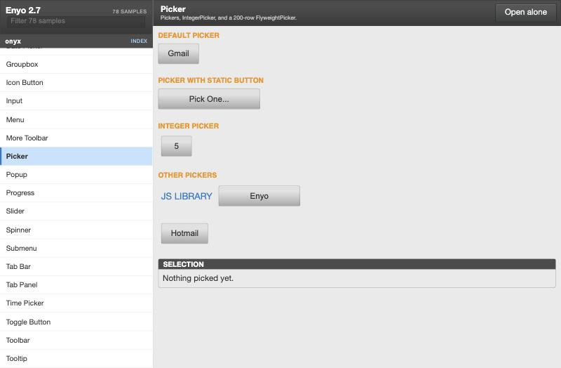

# enyo-sampler

One page that runs every Enyo 2.7 sample, across all three libraries.

`enyojs/sampler` was the original of this: a repo that pulled enyo, layout and
onyx together by git submodule and gave you one page to browse their samples
from. It was last touched in 2015, is wired to Enyo 2.5, and cannot be used.
This is the same idea rebuilt for the ES-module forks — minus the submodules,
which are what made the original so brittle.



## What it does

A list of all 78 samples on the left, the selected one **running** on the
right. It opens with a sample already going, so there is nothing to click
through before you see Enyo do something.

| | |
| --- | --- |
| Pick one | Tap a row. The sample loads beside it. |
| Find one | Type in the filter. It matches the label, the module name, the library and the blurb — so `drag`, `locale` or `arranger` all find something. |
| Keyboard | Return takes the first match, Up and Down step through the matches, Escape clears the filter. Two or three letters and a Return is the whole journey. |
| Link to one | The URL carries it: `#onyx/MenuSample`. Back and Forward walk the samples you have looked at. |
| See it alone | **Open alone** is a real link to the sample's own page, on its own — for the ones that want the whole window, and for devtools. |
| On a phone | Under 800px the list collapses and the sample takes the screen, with a Samples button to get back. |

## Running it

Clone the forks next to each other, all on their `esm` branches:

```
some-directory/
  enyo/
  layout/
  onyx/
  enyo-ilib/      # only the two onyx i18n samples need this
  enyo-sampler/   # this repo
```

Then serve **the directory that holds them**, not any one of them:

```bash
python3 layout/test-layout/serve.py 8000 /path/to/some-directory
```

and open <http://localhost:8000/enyo-sampler/index.html>.

The root matters because the pages resolve bare specifiers (`enyo/src/...`,
`onyx/src/...`) through an import map that assumes the checkouts are siblings
under one origin. Point the server inside a single repository and nothing
resolves — so if a library is not where it should be, the page says which one
and carries on with the rest, rather than letting you click into a 404.

`serve.py` lives in the layout fork and disables caching. Use it rather than
`python3 -m http.server`: the latter lets the browser cache ES modules, and a
query string on the page URL does not bust them, so a reload can silently
re-run stale code and report a pass for a change that is not there.

## What is here

| file | |
| --- | --- |
| `index.html` | the import map, the stylesheets, and six lines of bootstrap |
| `Sampler.js` | the shell — a `Panels` under a `CollapsingArranger` |
| `Sampler.css` | its colour and type; everything structural is layout's and onyx's |
| `manifests.js` | reads the three libraries' sample lists |

**No samples.** They live in the library they demonstrate, which is where
upstream had them and where they belong: a sample is documentation for its
library, and it should move, break and get fixed along with it. Each library
keeps its own annotated index as well — the full list with every blurb spelled
out — and each section header here links to it.

| library | samples | its own index |
| --- | ---: | --- |
| [enyo](https://github.com/drahgon55/enyo) | 33 | `enyo/samples/index.html` |
| [layout](https://github.com/drahgon55/layout) | 23 | `layout/samples/index.html` |
| [onyx](https://github.com/drahgon55/onyx) | 22 | `onyx/samples/index.html` |

78 in all, ported from the `2.5.1-release` tag of each upstream repository —
the last tag that still had them, before 2.6 deleted every `samples/` folder.
Those counts are read from each library's `samples/samples.js` at load time
rather than written down here, so the page cannot be wrong about them; this
table can, and is the only copy that has to be maintained by hand.

That also means this repo is not self-contained and is not meant to be. It
links sideways out of itself, to sibling checkouts, by relative path.

## Two things the shell does that are worth knowing

**It is built out of the three libraries it demonstrates**, which is the
point: a `Panels` under a `CollapsingArranger`, with `FittableRows`, an
`enyo/Scroller`, and onyx's toolbars, items and inputs. The responsive
behaviour is not hand-written CSS — it is `PanelsFlickrSample` doing
master/detail, pointed at samples instead of photographs. So the sampler is
itself the seventy-ninth sample, and if the layout breaks, something in layout
is broken.

**Each sample runs in an iframe**, pointed at the `sample.html?s=<Name>` page
its own library already has. Rendering the sample's kind straight into a panel
would be the showier choice and would not survive these samples: they are
whole-page apps that assume they own the viewport, their stylesheets are not
scoped and would collide, and they leave behind listeners, jobs and body
classes that `destroy()` does not clean up. Replacing a frame's document
disposes of all of it, and one sample throwing takes down its frame and
nothing else. `Sampler.js` says more, including why the frame is navigated
with `location.replace()` rather than by assigning `src`.

## Why the forks exist

Enyo 2.7 was never released as ES modules. These forks convert each library to
native ES modules with no bundler and no build step, so a browser can load the
framework directly through an import map. Each fork's `MIGRATION.md` documents
its conversion, and each `samples/README.md` documents what porting that
library's samples turned up — including several latent bugs that only became
visible once the code ran under a module's strict mode.
